# CaseWeave 1.1

CaseWeave is a browser-based evidence workspace for investigative journalists, legal researchers, compliance teams, and independent investigators. It connects original documents and exact passages to facts, events, entities, issues, and reports. The fictional Harborline Procurement Review opens on first launch.

## Open on Windows

1. Open the `caseweave` folder in File Explorer. If you received a ZIP, extract it first.
2. Open `dist` and double-click **index.html**. If Windows asks which app to use, choose a recent version of Google Chrome or Microsoft Edge.
3. **Success indicator:** CaseWeave opens directly to the Harborline Procurement Review. The browser’s address bar starts with `file:///` when you use the portable build.

The portable build contains the app, document parsers, and OCR models. The core workflow works offline without an installation, terminal, or account. Open the same build location and browser profile to continue work. A static-hosted copy or the optional Windows relay opens at a different address with its own browser storage.

### Upgrade from 1.0

1. In your 1.0 workspace, export each project from **Settings → Export backup**. Keep the original folder and backups until the upgrade is verified.
2. Open the 1.1 build. If you update the HTML at the same path and use the same browser profile, CaseWeave reads the existing workspace and initializes the new features. If you use a new path, browser, or the Windows relay, use **Investigations → Restore backup** to import a copy. Version 1.0 and 1.1 backup formats are supported.
3. **Success indicator:** Open a familiar event and follow its citation to the exact passage. Check **Settings → Trash** for the new recovery view.

## Take the fictional case through the workflow

1. **Open a project.** On the dashboard, click **Investigations** to switch, rename, or create a project. The demo keeps its evidence and records separate from newly created projects.
2. **Review a document.** Open **Evidence Library** and search for `PO-0247`. Open **Signed purchase order.txt**, then run **Check file integrity**. The success message should say the original matches the recorded SHA-256. Select text in one passage and choose **Highlight** or **Create fact**. The fact editor opens with the exact quotation attached.
3. **Place events in time.** Open **Event Timeline**, filter for **Disputed**, and select **Vendor alleges installation started**. Click the vendor and finance citations. CaseWeave jumps to each document’s cited passage and marks it in the text. Add an event using **Add event**, then attach a source passage before marking it verified.
4. **Check connections.** Open **Relationships** and select an edge such as **Issued purchase order to**. Its inspector opens the cited purchase order. Turn on **Include events and evidence** to see explicitly linked records. Edge labels describe relationships entered by a reviewer or explicit links created by case records.
5. **Review suggestions and contradictions.** In **AI Analysis**, edit or approve either of the two demo suggestions. An approved fact appears under **Case records** as **Unverified**. Open **Issues** to compare the vendor and finance accounts and see what evidence is missing.
6. **Export and back up.** In **Reports**, choose **Export Markdown** or **Save as PDF**. In the print dialog, choose **Save as PDF** or **Microsoft Print to PDF**. Look for the event chronology, status of each finding, and numbered evidence quotations. Use **Settings → Export backup** to preserve the project and originals. Return to **Investigations → Restore backup** to restore it as a separate copy.

## What CaseWeave preserves

| Feature | Details |
| --- | --- |
| Original evidence | Multiple PDF, DOCX, TXT, and CSV files per upload. CaseWeave retains bytes, SHA-256, import time in UTC, original modification time when supplied, the source reference, and case notes and tags. Identical originals are detected within each project. |
| Passage references | PDF page and passage, DOCX body paragraph, TXT paragraph, or CSV logical row. Citations store exact character offsets and quoted text. PDFs have an original-page preview. Every source can be downloaded as originally imported. |
| Scanned PDFs | Run **OCR page** in the viewer. OCR runs on the device and is labeled as transcription. Compare the transcription with the original page before relying on it. English is the default. Select **简体中文** for Chinese and English OCR. |
| Timeline | Date-scaled points and date ranges, including overlap indicators, entity and tag filters, verification filters, and separate handling for undated events. Overlapping dates may be intentional. |
| Relationships | Selectable entities and edges. Manually added relationships require an exact source passage. Entity profiles can cite documents and connect to events through linked records. |
| Reports | Chronology, people, relationships, verified findings, disputed or unverified records, and unresolved questions. The evidence index includes original quotations, document locations, source references, and SHA-256. |
| Storage | File bytes and case records are saved in IndexedDB. Backups contain plaintext case data and original files. Use an appropriate location and operating system account for sensitive material. |

## Edit, remove, and recover records

1. Select a record and use its pencil control. For evidence, edit the display title, source, tags, notes, or review state in the Source Inspector. Its original filename and bytes are preserved.
2. Use **Move to Trash** in the edit form or the Trash control in the evidence inspector. Evidence, facts, events, entities, relationships, issues, annotations, and report drafts are recoverable individually.
3. Open **Settings → Trash** and choose **Restore**. Restore a document before restoring an annotation on it. **Success indicator:** a citation that read **Source in Trash** opens the exact original passage again. Entity relationships reappear when both endpoints and their sources are available.

While an original is in Trash, dependent verified facts and reviewed draft sections display a lower review status. Permanent removal strips citations to that file, removes its annotations, and resets affected statuses. Permanently removing an entity clears its event associations and removes its relationships. Written descriptions and previously exported copies may retain information from the removed record. **Delete investigation** removes the whole project, including its Trash. Export a backup first if you need to retain it.

## Connect optional AI on Windows

### Windows relay for services that block browser requests

1. Double-click **CaseWeave AI Relay.exe** in the extracted folder. In the Windows window, enter the API base URL, model ID, and any required key. Examples include `https://api.openai.com/v1`, `https://openrouter.ai/api/v1`, or a loopback model such as `http://127.0.0.1:11434/v1`. Choose **Save provider**.
2. Choose **Open workspace** and leave the relay window running. In the browser, open **Settings → Test Windows relay**. **Success indicator:** the model appears as **Connected**. The test sends a fixed prompt to the configured endpoint.
3. If you have an existing portable project, export it there and restore it in the relay workspace at `http://127.0.0.1:4179`. Continue opening this same address through the relay to use that copy. To remove the configured key from the relay session, use **Clear provider** in the Windows window or close it. Browser **Disconnect** clears the browser connection for that tab.

The relay runs on Windows using the installed .NET Framework and listens only on loopback. It requires a short-lived launch link, an authenticated same-site browser session, and the matching provider revision for each request. Only the endpoint set in the native window receives requests. The key stays in relay process memory and travels to the selected upstream service when required. The relay uses Windows TLS validation for remote HTTPS. The packaged launcher is an unsigned local build with source in `relay/`. If Windows policy blocks it or port 4179 is unavailable, the portable workspace remains usable. [OpenAI key guidance](https://help.openai.com/en/articles/5112595-best-practices-for-api-key-safety)

### Direct browser connection

Use **Settings → Direct provider** for a credential-free local model or endpoints that permit requests from your workspace origin. Enter a Chat Completions model and click **Test and connect**. If the browser blocks the request, use the Windows relay. A direct credential is held in browser-tab memory. A trusted relay keeps the provider credential outside the browser.

## Analyze a collection in batches

1. In **AI Analysis**, choose a task, select documents, and choose a batch size. Smaller batches help with short model context windows. **Preview AI request** shows the destination, each batch’s exact source ranges, and the number of requests. **Allow and send** authorizes those batches. A provider may retain input or charge per request.
2. Use **Pause after current batch** if needed. Open **Analysis runs** to see completed, partial, failed, and skipped coverage per document. Resume or retry remaining batches with fresh consent. Image-only pages need OCR before their text can be included.
3. Review the queue. Identical pending findings from the same run are combined locally, with their citations retained. Use **Compare cited results** for a new, separately approved analysis of quoted evidence across completed batches. If that comparison itself needs multiple batches, each request still compares the passages in its own batch. **Success indicator:** the coverage table and batch details show which ranges were processed, and a cited result opens the original record.

Source matching checks quoted text and offsets. The investigator evaluates whether those words support the claim. A proposed agreement or contradiction needs citations from at least two different documents. Approved proposed facts enter the workspace as **Unverified**. A completed batch means the model returned readable analysis for that input. It does not measure the model’s attention to every passage.

## Turn AI sections into a report

1. In **AI Analysis**, select **Draft report** and select documents cited by verified records. The preview shows the relevant verified-record excerpts and exact source passages. Send only after reviewing the payload.
2. In **Verification queue**, choose **Add to draft** for a cited suggestion. Select or create a destination draft. In **Reports → Report drafts**, edit the section, inspect its citations, and check **I checked the section against its sources** when ready.
3. Add your own sections and use the arrows to reorder them. Export **Markdown** or choose **Save as PDF** and select the browser’s PDF destination. **Success indicator:** section order, review labels, and numbered source references match the draft. The export includes quoted evidence, locations, and original-file hashes.

## Data security and operating limits

- CaseWeave is a single-user browser workspace. IndexedDB is scoped to a browser profile and address. Browser data can be cleared or evicted. Persistent storage is a browser preference. Anyone with access to the profile or a privileged browser extension may be able to read case data. Use a separate protected OS account or profile for sensitive cases. [Browser storage and eviction](https://developer.mozilla.org/en-US/docs/Web/API/Storage_API/Storage_quotas_and_eviction_criteria)
- JSON backups are plaintext and contain original files, notes, drafts, Trash, and analysis history. Store them on encrypted storage and control who can copy them. The backup limit is 300 MB. Permanent deletion inside CaseWeave removes app records. Browser files, exported copies, and provider-held data have separate retention.
- SHA-256 checks whether original-file bytes match the saved digest. It provides no independent authentication of who supplied a document or whether its statement is true. Indexed text, OCR, annotations, and review states are editable or derived data. Check important citations against the preserved original. The local activity list is editable by someone with browser storage access.
- Individual imports are capped at 35 MB and PDFs at 500 pages. Unlock protected PDFs before importing. DOCX preview extracts main-body text. Use UTF-8 or BOM-marked UTF-16 for TXT and CSV. Download an original when you need the complete layout or attachment data.
- **Settings → Language** switches interface, forms, application messages, and report labels between English and Simplified Chinese. AI work uses the selected language and OCR can recognize Simplified Chinese plus English. Evidence, project text, model names, and previously saved notes retain the language in which they were recorded. Native browser and OS dialogs use their own language settings.

## Product research

| Reference | Applied in CaseWeave |
| --- | --- |
| [Casefleet fact extraction](https://support.casefleet.com/en/articles/13057134-using-the-ai-assistant-to-create-facts) and [citation navigation](https://support.casefleet.com/en/articles/12293100-understanding-ai-responses-and-citations) | The proposed fact queue requires human approval. A citation opens the passage in context. |
| [Everlaw Storybuilder](https://www.everlaw.com/storybuilder/) and [workspace guide](https://support.everlaw.com/hc/en-us/articles/206439403-Introduction-to-Storybuilder) | Case records, people profiles, and the chronology share evidence references. |
| [DocumentCloud projects](https://help.muckrock.com/DocumentCloud-Projects-406f889269638124bf44ee96ffa0f65a) and [page annotations](https://documentcloud.github.io/help_center/help/annotate_documents.html) | Search covers imported text and metadata. A passage-level highlight stays attached to its source. |
| [OCCRP Aleph documentation](https://docs.aleph.occrp.org/) and [investigation workspaces](https://docs.aleph.occrp.org/users/investigations/create/) | People, organizations, and records have distinct types. Cross-document comparisons keep their supporting passages. |
| [Linkurious graph manual](https://doc.linkurious.com/user-manual/latest/page.html) | Graph nodes and edges are selectable. Filters narrow the view and the inspector shows the evidence behind a connection. |
| [Hunchly’s capture and preservation workflow](https://hunch.ly/) | Evidence retains original bytes, source information, timestamps, and a checkable digest. |

## Development and verification

The source uses React, Vite, IndexedDB, PDF.js, and Tesseract.js. Developers with Node.js 22 or later can run `npm ci` and `npm run build`. These commands download the locked dependencies and recreate `dist/index.html`.

Run `npm test` after building to exercise the portable file in an installed Chrome browser on Windows. The tests use isolated profiles and synthetic records. They cover import, OCR in both languages, exact citation navigation, restart persistence, Trash and linked records, recovery from a backup, batch pause and retry, report editing and export, and relay credential isolation. To use Edge, set `CASEWEAVE_TEST_BROWSER=msedge` before running the test. Rebuild the optional native launcher with `relay/build.ps1` on Windows.

Live transport checks used a real llama.cpp server with a synthetic API key and obtained an authenticated Chat Completions response through the relay. Credential-free HTTPS checks reached OpenAI and OpenRouter and returned their expected `401` responses. Authenticated cloud inference requires provider credentials and was outside that test. The CORS test uses a local service that accepts authentication but omits CORS headers. [llama.cpp server interface](https://github.com/ggml-org/llama.cpp/blob/master/tools/server/README.md)

The DOCX parser uses fflate 0.8.3, which fixes the malformed ZIP64 import hang. [fflate advisory](https://github.com/advisories/GHSA-px8p-9vwx-vf98)

## Screenshots

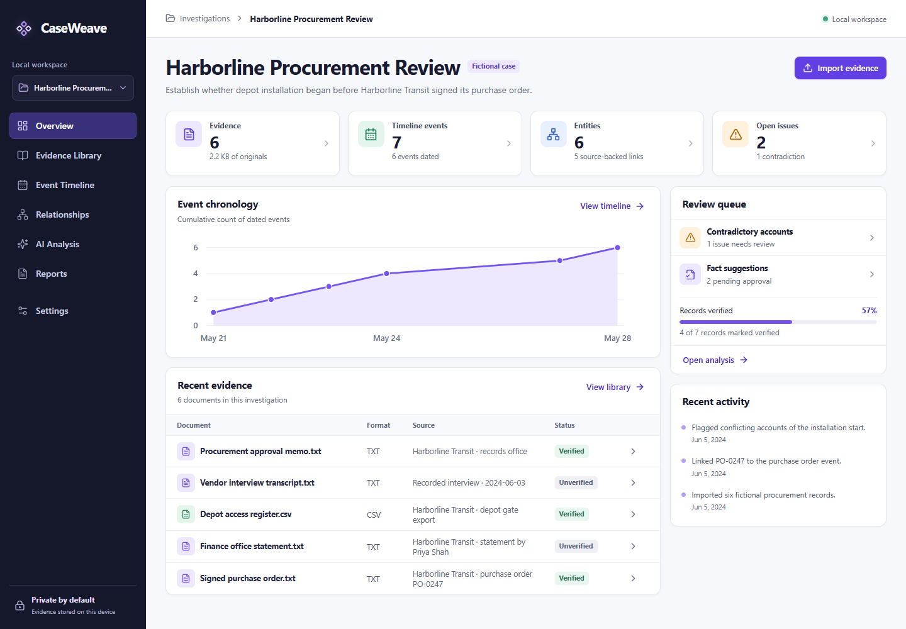

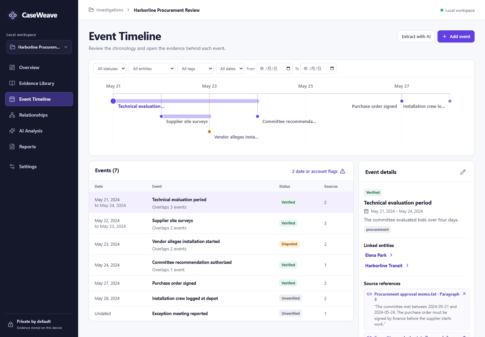

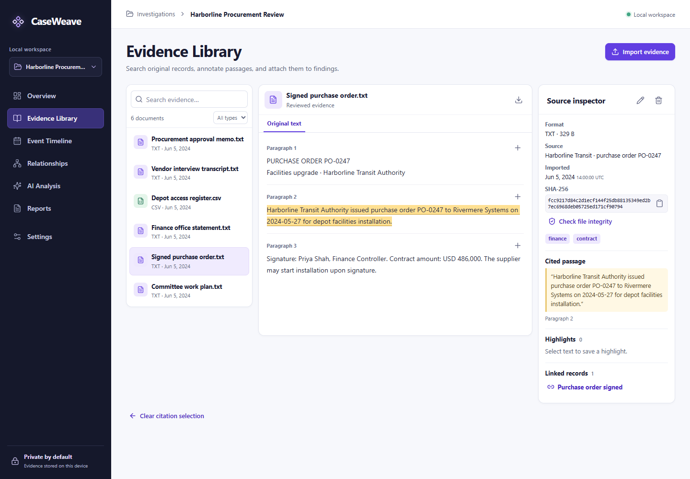

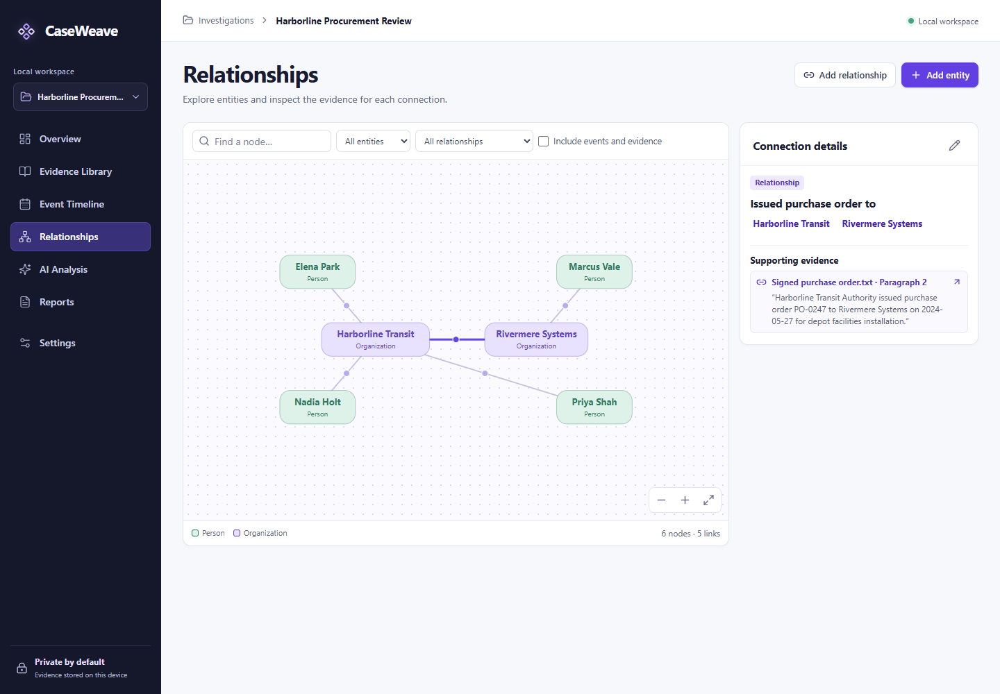

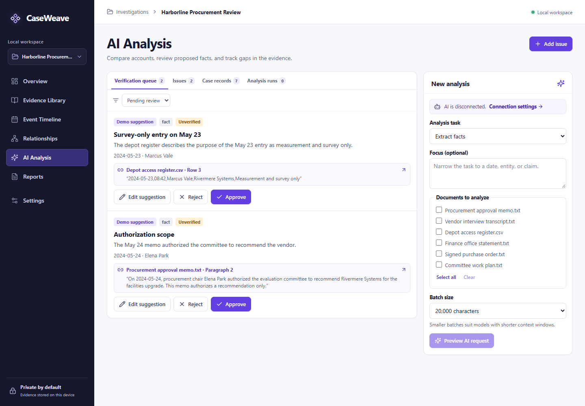

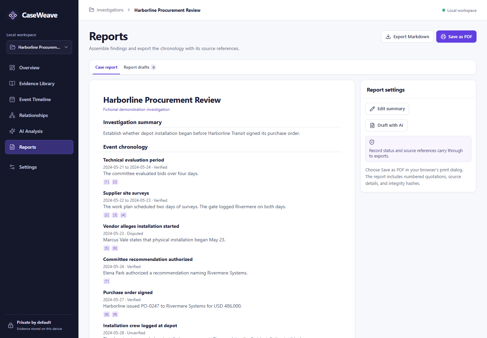

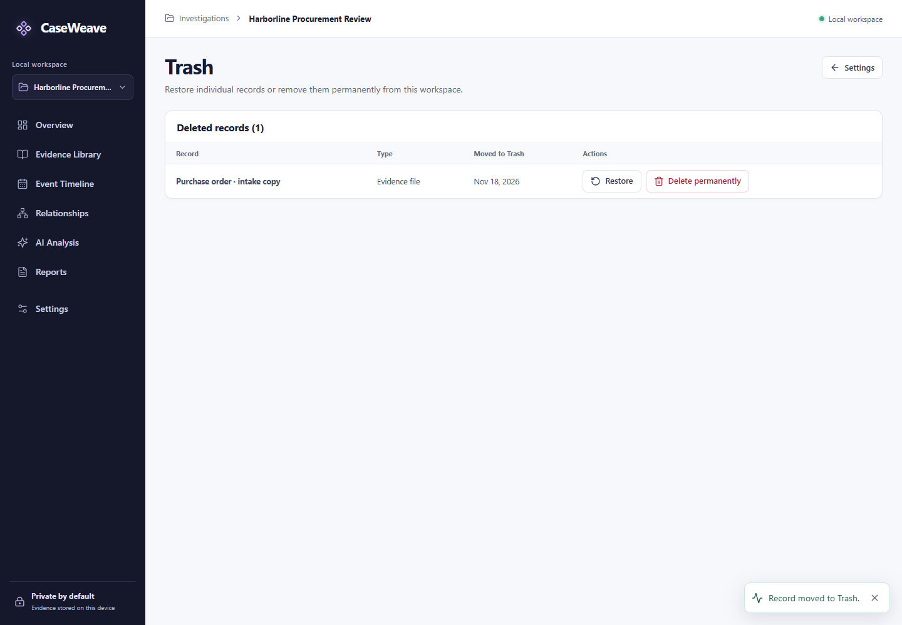

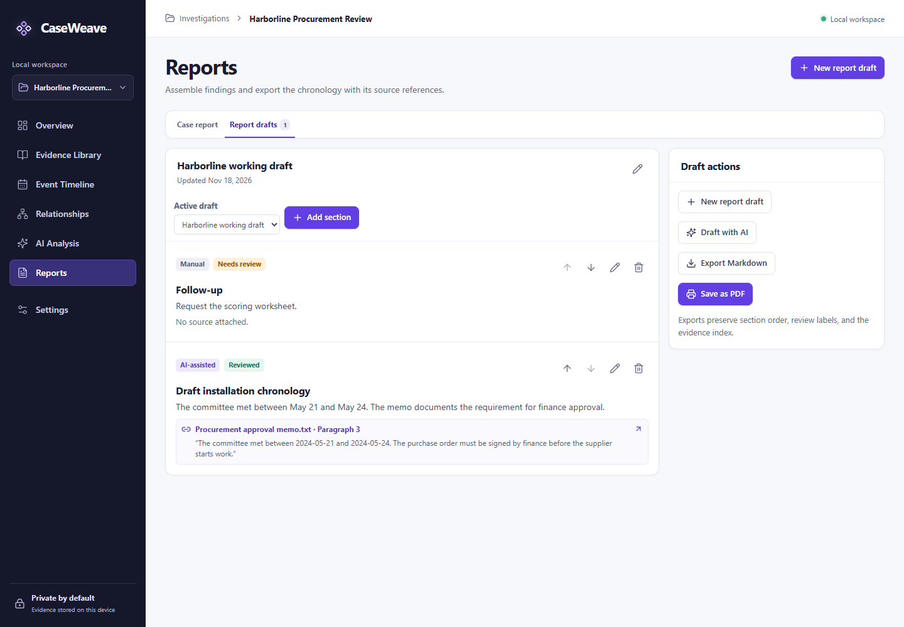

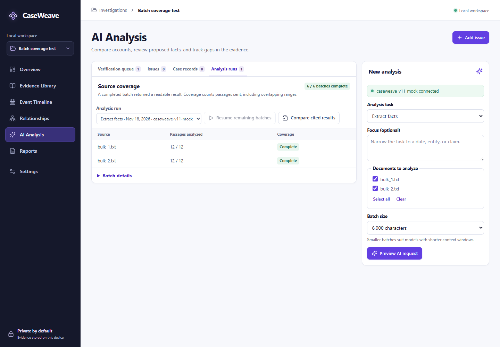

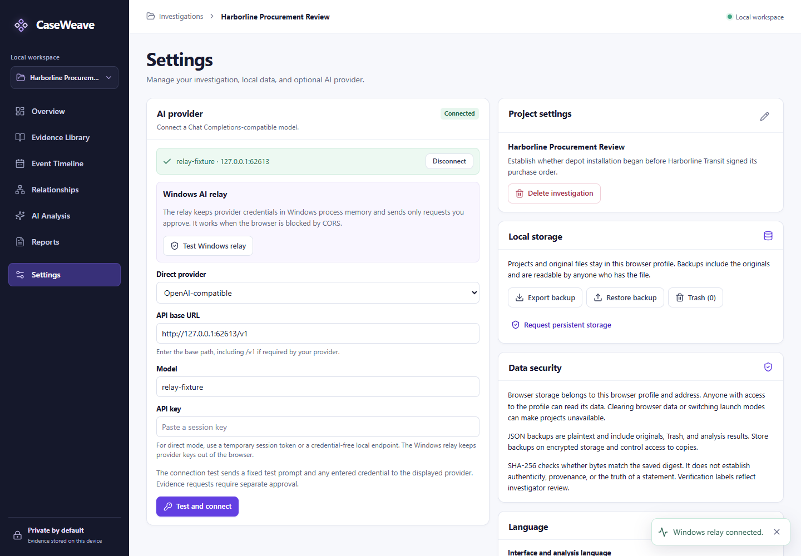

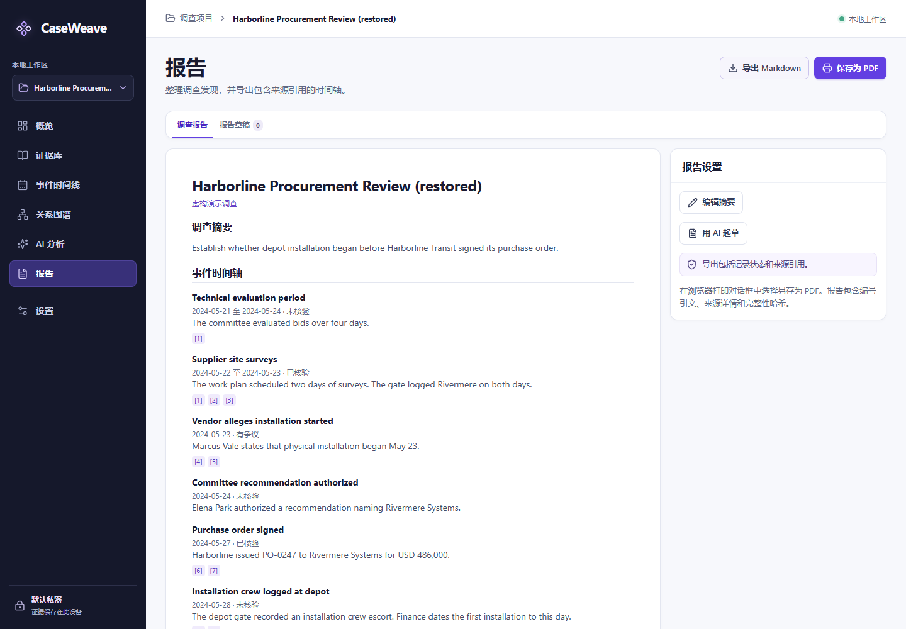
